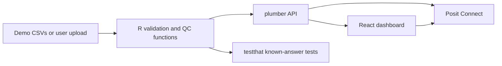

# Blood Bank Supply Integrity Tool — Team Project Plan

> **Scope update:** The attached BloodWatch starter prompt supersedes this early planning draft where they differ. The active implementation uses React/Vite, Python/FastAPI, a constant-rate mechanical failure model, and a per-blackout-demand generator model. See [`interfaces.md`](interfaces.md) and [`team-plan.md`](team-plan.md).

Working title: **ColdGuard** (placeholder; the team can rename it)

## 1. One-sentence product definition

ColdGuard helps a regional blood-bank operations manager decide **which refrigerator or backup generator needs action now** by combining temperature and power-status monitoring with transparent equipment-failure risk estimates.

The prototype is a decision-support and educational tool. It is not a validated clinical device, and it must not decide whether blood is safe for transfusion.

## 2. Why this scope fits the challenge

The hackathon grades the statistics as the core and the app as their delivery vehicle. The proposed minimum viable product (MVP) therefore focuses on three questions:

1. **Is stored supply currently at risk?** Flag temperature excursions, power loss, failed generator starts, stale sensors, and missing data.
2. **Which refrigeration unit is most likely to fail soon?** Estimate conditional failure risk from right-censored equipment history with a Weibull reliability model.
3. **Which generator is least likely to start when needed?** Estimate next-start failure probability from routine generator-test outcomes with a beta-binomial model.

The value-at-risk display (`inventory_value_usd`) helps prioritize response, but it is not used to manufacture a risk estimate.

## 3. Intended user and decision

- **Primary user:** the regional blood bank's facilities or quality manager.
- **Decision:** at the beginning of a shift and after any alert, decide whether to inspect a unit, transfer inventory, service a generator, or continue monitoring.
- **Secondary audience:** maintenance staff, who need to see why an asset was flagged.
- **Success criterion:** the user can identify the highest-priority asset and the evidence behind that recommendation in under 60 seconds.

## 4. Recommended technical stack

Use **R for all statistics**, a **plumber REST API**, and a **React/Vite front end**. This fits the course's React-plus-statistical-tool wording, uses the team's existing R context, and keeps every statistic in a plain, testable `app/qc.R` file.



Recommended repository shape after the official starter is forked or cloned:

```text
app/
  qc.R                 # plain statistical functions only
  plumber.R            # input validation and API routes
  frontend/            # React/Vite application
  testme.*             # one-command local startup
  manifestme.*
  deployme.*
tests/
data/
  stable/
  degrading/
  blackout/
  README.md            # data codebook
demo/
  README.md            # exact walkthrough and expected results
docs/
  plan.md
SPEC.md
CONTRACT.yaml
README.md
```

If the organizers explicitly confirm that a Shiny-only submission satisfies the current delivery rule, Shiny is a reasonable simplification. Until then, React + plumber is the safer interpretation of the published requirements.

## 5. MVP user experience

### Page 1 — Regional overview

- Red/amber/green status for each site and asset.
- Cards for active excursions, stale sensors, failed generator tests, estimated inventory value at risk, and assets with elevated near-term risk.
- Ranked action table with: asset, issue, evidence, suggested operational follow-up, and timestamp.
- Clear distinction between:
  - **ALARM:** an observed rule violation now.
  - **WARNING:** a statistically unusual pattern or elevated model estimate.
  - **OK:** no current trigger in the available data.
  - **UNKNOWN:** insufficient or stale data.

### Page 2 — Asset detail

- Temperature time series with user-configured acceptable limits.
- Power-loss and generator-start events overlaid on the plot.
- Model result: failure probability over the selected horizon, uncertainty interval, model assumptions, and sample size.
- A plain-language “how to read this” sentence beside every result.

### Page 3 — Data and methods

- Load one of the three built-in scenarios or upload the documented CSV files.
- Preview validation errors before analysis.
- Display formulas, assumptions, data provenance, and limitations.
- Download a result table for the demo; no database, login, or live notifications in the MVP.

## 6. Minimal data contract

Use only data that a real facility could obtain from sensor logs, maintenance records, routine generator tests, and an inventory system.

### `telemetry.csv` — one row per sensor reading

| Column | Type/unit | Purpose |
|---|---|---|
| `timestamp` | ISO-8601 with time zone | Sequence readings and detect stale data |
| `site_id` | text | Regional grouping |
| `asset_id` | text | Refrigerator/freezer identifier |
| `temperature_c` | degrees C | Supply-integrity monitoring |
| `mains_power` | 0/1 | Detect an outage |
| `generator_running` | 0/1 | Detect whether backup power took over |
| `inventory_value_usd` | nonnegative USD | Operational prioritization only |

### `refrigerator_history.csv` — one row per completed or censored operating interval

| Column | Type/unit | Purpose |
|---|---|---|
| `asset_id` | text | Equipment identifier |
| `model_group` | text | Fit comparable equipment together |
| `operating_days` | positive days | Time to failure or censoring |
| `failed` | 0/1 | 1 = failure observed; 0 = still operating/end of interval |

### `generator_tests.csv` — one row per scheduled or real start attempt

| Column | Type/unit | Purpose |
|---|---|---|
| `asset_id` | text | Generator identifier |
| `timestamp` | ISO-8601 with time zone | Order and freshness of tests |
| `started` | 0/1 | Outcome of the start attempt |
| `attempt_type` | `scheduled_test` or `outage` | Context for the attempt |

Thresholds are user-configurable and must never be presented as universal clinical rules. For the red-cell demo, document the source and use an FDA-supported storage range of **1–6 °C**. WHO material describes blood-bank refrigerator operation at **2–6 °C**, so the app should distinguish an operational warning band from the configured product storage limit.

## 7. Statistical plan

### 7.1 Observed supply-integrity rules

These are deterministic, not predictions:

- Flag any temperature reading outside the configured product limits.
- Report the start time, duration, minimum/maximum temperature, and affected value for each excursion.
- During mains failure, flag `generator_running = 0` after a configurable grace period.
- Mark an asset `UNKNOWN`, not `OK`, when required readings are missing or stale.
- Never infer product disposition. The UI says “review/transfer/escalate per local SOP,” not “discard” or “safe.”

### 7.2 Refrigerator failure prediction — Weibull reliability

Fit a Weibull distribution separately within a defensible `model_group`, using observed failures and right-censored operating intervals.

For shape `beta`, scale `eta`, present age `t`, and forecast horizon `h`, calculate conditional failure risk:

```text
P(failure by t+h | survived to t)
  = 1 - exp(-[((t+h)/eta)^beta - (t/eta)^beta])
```

Report `beta`, `eta`, number of assets, number of failures, the horizon, the point estimate, and an uncertainty interval. If there are too few events, return `insufficient history` instead of a confident-looking number.

Assumptions to display:

- operating intervals are independent;
- assets within a model group are sufficiently comparable;
- censoring is non-informative;
- maintenance and operating conditions are reasonably stable;
- recorded failures and ages are accurate.

Known-answer test before UI work:

- With `beta = 1`, `eta = 1000 days`, current age `t = 500 days`, and `h = 100 days`, the conditional risk must equal `1 - exp(-0.1) = 0.09516258`.
- Degenerate tests: empty history, all observations censored, nonpositive times, `h = 0`, missing values, and an asset model absent from the history.

### 7.3 Generator next-start failure — beta-binomial estimate

For a generator with `f` failed starts and `s` successful starts, use a documented weak prior `Beta(1,1)`. The posterior is `Beta(1+f, 1+s)`, and its mean next-start failure probability is:

```text
(1 + f) / (2 + f + s)
```

Show a 95% credible interval and counts alongside the probability. This estimate is conditional on future starts being comparable to prior tests; it is not a guarantee.

Known-answer test:

- For 2 failed and 8 successful starts, posterior mean failure probability is `3/12 = 0.25`.
- Degenerate tests: no tests, one test, missing outcome, and nonbinary outcome.

### 7.4 Optional stretch statistic

Only after the two reliability functions and their tests pass, add an Individuals/Moving Range or EWMA chart for temperature drift. Account for sampling cadence and explicitly discuss autocorrelation; do not label ordinary sensor noise as independent measurements without checking that assumption.

## 8. Three synthetic demonstration scenarios

All data must be labeled **synthetic**.

1. **Stable site:** temperatures remain within limits, mains power is steady, generator tests mostly succeed, and refrigerator risk is low. Expected outcome: no active alarm.
2. **Degrading refrigerator:** rising age/failure risk plus a planted temperature excursion. Expected outcome: the unit ranks first for inspection and its inventory value is shown as exposed.
3. **Blackout and failed start:** mains power drops and the generator fails to start before temperatures rise. Expected outcome: a critical observed alarm, with the generator history explaining elevated next-start risk.

Use fixed random seeds and record the planted behavior in `data/README.md`. Never describe simulated records as real blood-bank data.

## 9. Test and validation strategy

The build order is statistics first:

1. Unit-test every formula against the known answers above.
2. Test data validation: required columns, units, timestamp order, duplicate rows, missing values, impossible values, and empty files.
3. Test scenario expectations: stable has no alarm; degrading has the planted excursion; blackout has the failed-start alarm.
4. Test API output against direct calls to `qc.R`; the values must match.
5. Have a teammate who did not write the feature follow `demo/README.md` from a fresh clone.
6. Test the deployed URL in a logged-out browser.

For each displayed number, the team should be able to answer: input rows used, formula, assumptions, units, and expected behavior when data are missing.

## 10. Work plan and ownership

The official `CONTRACT.yaml` tasks should remain the task ledger. Assign one owner to each active item and avoid simultaneous edits to the same files.

| Workstream | Primary owner | Reviewer | Contract task |
|---|---|---|---|
| Scope, user, and decisions | Product/data lead | Whole team | H-01 |
| Synthetic data and codebook | Data lead | Statistics lead | H-02 |
| Reliability functions and tests | Statistics lead | Independent reviewer | H-03 |
| plumber API and React app | App lead(s) | Statistics lead | H-04 |
| Demo walkthrough | UX/demo lead | Teammate unfamiliar with feature | H-05 |
| Posit Connect deployment | Deployment lead | App lead | H-06 |
| Public documentation | Documentation lead | Whole team | H-07 |
| Reproducibility and Devpost | Team coordinator | Whole team | H-08 |

For a two-person team, combine product/data/statistics and app/deployment/docs. For a three-person team, use statistics/data, app, and product/docs/deployment. For four or five people, use the workstreams above.

## 11. Calendar for the current DL deadline

The published schedule runs through **Friday, October 23 at 3:00 PM ET**. Because this plan is being created on Monday, October 19, treat today as a compressed kickoff rather than assuming seven untouched days remain.

### Monday, October 19 — freeze scope

- Fork/clone the official starter into the team repository.
- Fill `SPEC.md` together and assign H-01 through H-08.
- Confirm React + plumber, the exact product threshold used in the demo, and the failure-risk horizon.
- Create the three data scenarios and codebook outline.
- Write formula tests before building interface components.

Exit condition: scope is frozen, data schemas are agreed, and both known-answer tests pass.

### Tuesday, October 20 — complete statistical core

- Finish synthetic datasets and codebook.
- Fit Weibull models with censoring and beta-binomial generator estimates.
- Complete degenerate-case and validation tests.
- Expose only tested results through plumber endpoints.

Exit condition: H-02 and H-03 pass their definitions of done.

### Wednesday, October 21 — working vertical slice and first deployment

- Build regional overview, asset detail, and data/methods views.
- Wire one scenario end-to-end.
- Add the remaining two scenarios.
- Deploy the simplest working version to Posit Connect before styling.

Exit condition: one command starts the tool locally; public URL works; app and direct function outputs match.

### Thursday, October 22 — demo, documentation, and hardening

- Finish clear action language, plots, mobile/desktop basics, and accessibility checks.
- Complete demo walkthrough and README.
- Run a fresh-clone test and have a non-author reproduce every scenario.
- Record a backup demo video or screenshots in case the live service fails.

Exit condition: all rubric rows have evidence and no unexplained number appears in the UI.

### Friday, October 23 — release and submit

- Morning only: fix critical bugs, check secrets, pin dependencies, verify logged-out URL.
- Freeze code by noon ET.
- Complete Devpost submission and verify links well before the 3:00 PM ET deadline.

## 12. Definition of MVP done

- A public React + plumber app runs from one documented command and is deployed.
- Three synthetic scenarios are included and documented.
- Current supply-integrity alarms are correct for the planted scenarios.
- Refrigerator and generator risk functions pass exact known-answer and degenerate-case tests.
- Missing/stale data produces `UNKNOWN`, never a false green status.
- Every output shows units, explanation, assumptions, and supporting sample size.
- A fresh clone passes tests and reproduces the demo.
- No secrets, patient data, or claims of clinical validation appear in the repository.

## 13. Out of scope for this hackathon

- Live IoT ingestion, SMS/email alerts, user accounts, or a production database.
- Patient-level or donor-level data.
- Automated blood disposition decisions.
- Machine-learning classifiers trained only on synthetic data.
- Cost optimization, inventory forecasting, route optimization, or multi-hospital transfers.
- A second visualization/statistic before the tested reliability MVP works end to end.

## 14. Main risks and mitigations

| Risk | Mitigation |
|---|---|
| Too much app, too little statistics | Do not start styling until known-answer tests pass |
| Synthetic model looks more certain than it is | Label data synthetic; show event counts, uncertainty, and insufficient-data states |
| Medical threshold is oversimplified | Make limits configurable and cite the product-specific source |
| Temperature readings are autocorrelated | Keep SPC as stretch; state assumptions and avoid unjustified independence claims |
| Deployment fails late | Deploy a thin vertical slice on Wednesday |
| Team merge conflicts | One owner per CONTRACT task and path; small reviewed commits |
| A judge cannot reproduce results | One-command start, pinned dependencies, fresh-clone test, backup demo |

## 15. Decisions the team must make in the kickoff meeting

Limit this meeting to 30 minutes and record the answers in `SPEC.md`:

1. Final team and product names, public repository URL, and task owners.
2. Confirm React + R/plumber or obtain organizer confirmation for a simpler stack.
3. Confirm demo focus: refrigerated red cells versus a broader configurable product model.
4. Confirm horizons shown (recommended: 7 and 30 days) and minimum event count before estimating risk.
5. Confirm the local operational action text with a knowledgeable teammate; the app must not invent a clinical disposition rule.

## 16. Sources used for this plan

- [Hackathon repository and delivery requirements](https://github.com/timothyfraser/sixsigmahackathon)
- [Evaluation criteria](https://github.com/timothyfraser/sixsigmahackathon/blob/main/docs/criteria.md)
- [Hackathon prompts and example statistical techniques](https://github.com/timothyfraser/sixsigmahackathon/blob/main/docs/prompts.md)
- [FDA example supporting 1–6 °C storage for red blood cells](https://www.fda.gov/vaccines-blood-biologics/approved-blood-products/solx-system)
- [WHO manual on management, maintenance, and use of blood cold-chain equipment](https://www.who.int/publications/i/item/92-4-154673-5)
